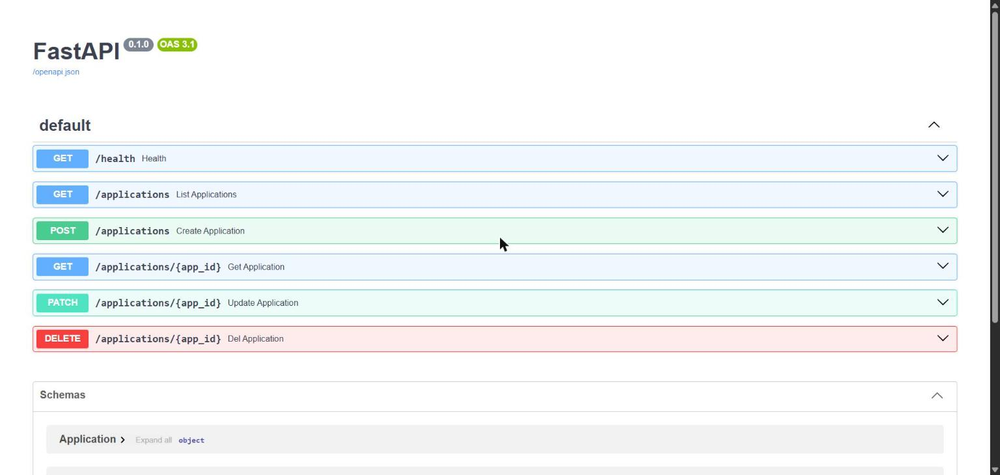

🇪🇸 [Leer en español](README.es.md)

# Job Tracker API


REST API to track job applications: save each posting, update its status (saved, applied, interview...) and review your history. A practice project to consolidate FastAPI, SQLite and testing with pytest.



## Tech stack

- Python 3.10+
- [FastAPI](https://fastapi.tiangolo.com/) + Uvicorn
- Pydantic v2 (data validation)
- SQLite (standard `sqlite3` module, parameterized queries)
- pytest + httpx (tests)

## Installation

```powershell
git clone https://github.com/EduardoRaffo/job-tracker-practice.git
cd job-tracker-practice
python -m venv .venv
.venv\Scripts\Activate.ps1      # on Linux/macOS: source .venv/bin/activate
pip install -r requirements.txt
```
## Run with Docker

```bash
docker build -t job-tracker .
docker run -d -p 8000:8000 -v tracker-data:/data --name tracker job-tracker
```

Open http://localhost:8000/docs. Data is stored in the `tracker-data` volume, so it survives container restarts.

## Usage

```bash
uvicorn main:app --reload
```

- API: http://127.0.0.1:8000
- Interactive docs (Swagger UI): http://127.0.0.1:8000/docs

The `tracker.db` database is created automatically in the working directory on the first request.

## Endpoints

| Method | Path | Description | Responses |
|--------|------|-------------|-----------|
| GET | `/health` | Checks that the API is alive | 200 |
| POST | `/applications` | Creates an application | 201 / 422 |
| GET | `/applications` | Lists all applications (empty list if none) | 200 |
| GET | `/applications/{id}` | Returns one application | 200 / 404 |
| PATCH | `/applications/{id}` | Updates only the fields sent | 200 / 404 / 422 |
| DELETE | `/applications/{id}` | Deletes an application | 204 / 404 |

### Example

```bash
curl -X POST http://127.0.0.1:8000/applications \
  -H "Content-Type: application/json" \
  -d '{"company": "Acme", "position": "Junior Python", "status": "applied"}'
```

```json
{
  "company": "Acme",
  "position": "Junior Python",
  "status": "applied",
  "id": 1
}
```

## Data model

| Field | Type | Notes |
|-------|------|-------|
| `id` | integer | Auto-generated, not reused after deletion |
| `company` | text | Required, 1 to 120 characters |
| `position` | text | Required, 1 to 120 characters |
| `status` | enum | `saved` (default), `applied`, `interview`, `offer`, `rejected` |

## Tests

```bash
pytest -q
```

The tests replace the `get_db` dependency with a temporary SQLite database (`dependency_overrides` + `tmp_path`), so they never touch `tracker.db`. They cover all six endpoints, including error cases (404, validation) and PATCH with an empty body.

## What I learned

- Designing a REST API with FastAPI: routes, status codes and Pydantic models to validate inputs and outputs.
- Persistence with SQLite and parameterized queries, using one connection per request through dependency injection (`Depends`).
- Partial updates with PATCH (`model_dump(exclude_unset=True)`).
- Reading tracebacks and debugging 422 and 500 errors.
- Writing isolated tests with pytest, fixtures and `dependency_overrides`.

## License

[MIT](LICENSE)
